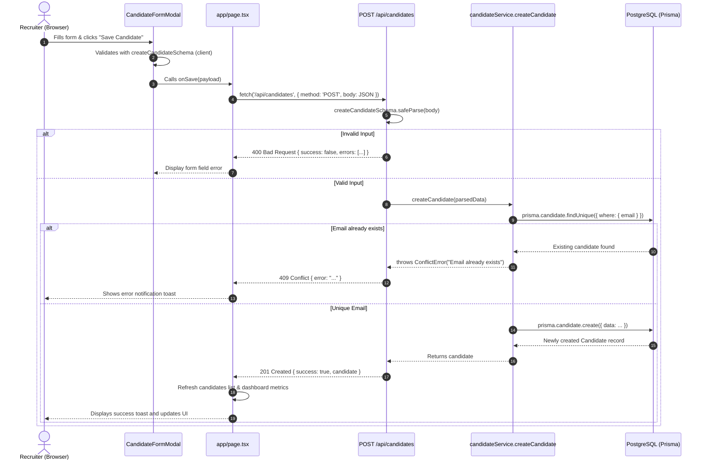
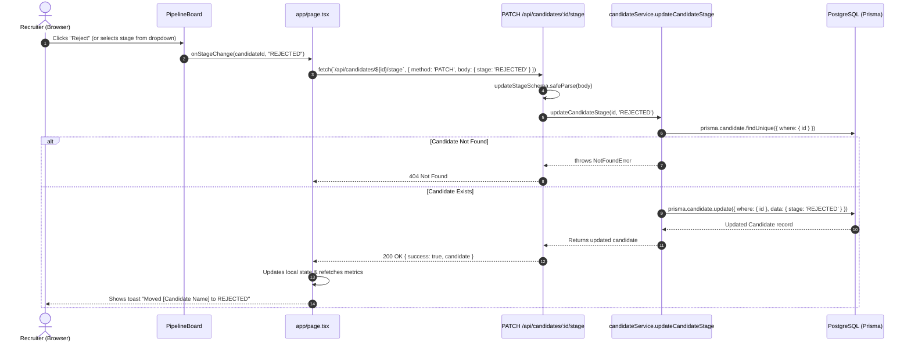

# Request Flows & Execution Traces

This document details the exact execution paths for key user workflows in the Mini ATS, following data from the browser to the PostgreSQL database and back.

---

## 1. Flow: Creating a New Candidate



---

## 2. Flow: Moving Candidate to "Rejected" or "Interview" (Pipeline Board)



---

## 3. Flow: Candidate Search and Filtering

1. **User Interaction**:
   - The user enters text into the search bar (e.g., `"Frontend"`) or chooses a stage filter (e.g., `"SCREENING"`).
2. **Client State**:
   - `components/candidates/candidate-filters.tsx` triggers `onSearchChange` or `onStageChange`.
   - `app/page.tsx` updates `filters` state and triggers `fetchCandidates(filters)`.
3. **HTTP Query**:
   - Client sends `GET /api/candidates?search=Frontend&stage=SCREENING&page=1&limit=50`.
4. **Validation**:
   - `candidateQuerySchema.safeParse(query)` verifies parameters.
5. **Database Execution**:
   - `candidateService.getCandidates` constructs a `where` condition using insensitive SQL pattern matching:
     ```prisma
     where: {
       stage: 'SCREENING',
       OR: [
         { name: { contains: 'Frontend', mode: 'insensitive' } },
         { email: { contains: 'Frontend', mode: 'insensitive' } },
         { position: { contains: 'Frontend', mode: 'insensitive' } },
       ]
     }
     ```
   - Queries `prisma.candidate.count` and `prisma.candidate.findMany` concurrently via `Promise.all`.
6. **Response**:
   - Server responds with `{ success: true, candidates: [...], pagination: { total, page, limit, totalPages } }`.
   - Client updates candidate table view immediately.
